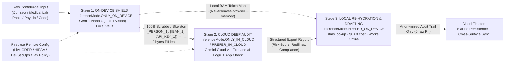

<p align="left">
  
</p>

# VeilAI — Zero-Leak Split-Brain Hybrid AI Workspace

[](./LICENSE)
[](https://firebasehybridaihackathon.devpost.com/)
[](https://firebase.google.com/docs/ai-logic)
[_%2B_Chrome_Extension-4285F4.svg)](#monorepo-architecture)

> **Use Frontier Cloud AI on your most confidential documents — without a single byte of sensitive data ever leaving your device.**
>
> 🌐 **Live Demo (Firebase Hosting)**: https://veilai-hybrid-2026.web.app *(Free 1-click Guest Mode — zero sign-up required)*
>
> Built with **Firebase AI Logic Hybrid Inference** (`Gemini Nano 4` On-Device + `Gemini 4 Hydrogen` Cloud), **Firebase App Check**, **Remote Config**, **Cloud Firestore Offline Persistence**, **Firebase Auth**, and **Firebase Hosting**.

---

## 🚨 The Problem

Lawyers, doctors, accountants, HR teams, and engineers want Frontier Cloud AI to review **NDAs, employment contracts, medical lab reports, payslips, tax filings, and proprietary pull requests**.

Today they face an impossible trade-off:
1. **Cloud-only AI** delivers deep reasoning, **but violates GDPR, HIPAA, NDAs, and client privilege** the instant raw PII or API credentials cross the network.
2. **On-device-only AI (`Gemini Nano`)** guarantees privacy and works offline, **but lacks the deep multi-clause reasoning and specialized legal/medical/security knowledge** needed for executive-grade audits.

---

## 💡 The Solution: Split-Brain Hybrid Inference

**VeilAI** turns **Firebase AI Logic Hybrid Inference** into a **Zero-Leak Privacy Firewall & Expert Review Pipeline** where **both** on-device and cloud models are architecturally indispensable — not merely an offline fallback:



### Intentional Use of All 4 Official `InferenceMode` Strategies

| Pipeline Step | `firebase/ai` Mode | Model | Why Hybrid Matters Here |
| :--- | :--- | :--- | :--- |
| **1. PII & Secret Detection / Redaction (Text & Image)** | `InferenceMode.ONLY_ON_DEVICE` | **Gemini Nano 4** (Chrome Built-in AI) | **Hard privacy invariant**: never falls back to cloud with raw PII. Works **100% offline** (Airplane Mode). |
| **2. Offline Quick Summary, Redline Refinement & Reply Drafting** | `InferenceMode.PREFER_ON_DEVICE` | **Gemini Nano 4** → Cloud fallback | Instant, **$0.00** local summaries and streaming counter-proposals while keeping private details on-device. |
| **3. Deep Expert Legal / Medical / Financial / Code Audit** | `InferenceMode.ONLY_IN_CLOUD` *(toggleable to `PREFER_IN_CLOUD`)* | **`gemini-4-hydrogen`** (`GoogleAIBackend`) | Receives **strictly tokenized text** (`[COMPANY_1]`, `[IBAN_1]`, `[API_KEY_1]`) for frontier reasoning Nano cannot match alone. |
| **4. Live Runtime Verification** | `result.response.inferenceSource` | Firebase AI Logic SDK | Every call records live **`ON_DEVICE`** vs **`IN_CLOUD`** execution source, latency, wire bytes, and estimated cost saved. |

---

## ✨ Key Features

### 1. 📄 Calm, Executive-Grade Document Studio (`apps/web`)
Designed for real practitioners — not a noisy developer dashboard:
* **Spacious Centered Document View**: Proportional reading typography for contracts, medical reports, and payslips (monospace reserved for source code), inline document renaming, and subtle interactive highlights on locally protected entities (click any highlight to toggle protection, or add custom confidential codenames inside `Manage`).
* **100% Client-Side PDF, Image & File Ingestion**: Click **`Upload`** or drag-and-drop any **`.pdf` contract/lab report** (parsed locally via lazy-loaded PDF.js in browser RAM — 0 bytes uploaded), **PNG/JPEG photo**, or **`.txt`/`.md`/source code file**.
* **Interactive Clause Navigation & Revision Tracking**: Click any clause reference (`Section 3 ↗`) in the Review panel to scroll directly to and illuminate that section inside the document; track accepted revisions (`Accept` → `2 of 4 accepted`), stream on-device tone refinements & counter-proposals, and export clean **Markdown (`.md`) Review Memos**.
* **Private Hybrid Follow-Up Q&A (`Ask about this document`)**: Ask custom questions about any document in **`On-device`** (`PREFER_ON_DEVICE`, `$0.00`, works offline) or **`Cloud`** (`ONLY_IN_CLOUD` + App Check) mode — even your questions are automatically scrubbed of PII locally before execution and re-hydrated in RAM.

### 2. 🔍 1-Click **Privacy & Hybrid AI Inspector** (Compliance & Judge Verification)
Click **`0 bytes leaked · Inspect`** in the top-right header to open the dedicated verification drawer:
* **Live SDK Telemetry**: Shielded entities, `0 B` PII leaked, `% On-Device` share, and estimated cloud cost saved.
* **`Simulate PII Leak Test`**: Deliberately injects a raw secret into the outbound payload to prove `verifyZeroLeak()` physically aborts transmission before any network socket opens.
* **`Benchmark Nano vs Cloud`**: Live side-by-side comparison proving why on-device alone is fast & free (`$0.00`) while Split-Brain Hybrid unlocks deeper clause redlines with zero PII exposure.
* **`Export SHA-256 Proof`**: Generates a Web Crypto SHA-256 verifiable JSON compliance certificate of the exact anonymized wire payload.
* **Live Firebase Remote Config & Airplane Mode Simulator**: Sync policies (`GDPR_EU`, `HIPAA_MEDICAL`, `DEVSECOPS_CODE`, `FINANCIAL_TAX`), toggle Stage 2 `ONLY_IN_CLOUD` ↔ `PREFER_IN_CLOUD`, simulate offline execution, and inspect live `result.response.inferenceSource` traces + exact outbound cloud prompt envelope.

### 3. 📸 Multimodal **Text & Image** On-Device Redaction
Switch to **Medical Lab Photo** (includes a programmatic sample clinical blood panel PNG) or drop any PNG/JPEG:
* **Gemini Nano 4 Vision** extracts and redacts patient PHI locally on-device (`ONLY_ON_DEVICE`), paired with a 1-click **Hide patient info** visual mask preview.

### 4. ✈️ True **Offline Mode** (Airplane Mode Ready)
Toggle **Simulate Offline** (or cut Wi-Fi in Chrome DevTools):
* Stage 1 local PII shielding (`ONLY_ON_DEVICE`) and quick local triage (`PREFER_ON_DEVICE`) keep working with **0 network requests**.
* Anonymized audit records queue transparently via **Cloud Firestore `persistentLocalCache()`** and sync automatically upon reconnect.

### 5. 🧩 Multi-Surface Monorepo: **Web App + Chrome Extension (Manifest V3)**
Both surfaces share `@veilai/hybrid-core` and synchronize anonymized audit history in real time via Firestore:
* **Web App (`apps/web`)**: Live on Firebase Hosting (`https://veilai-hybrid-2026.web.app`) with 1-click **Guest Mode** and 4 pre-loaded real-world scenarios (`NDA & Employment`, `Medical Lab Photo`, `Payslip & Tax`, `GitHub PR Secrets`).
* **Chrome Side-Panel Extension (`apps/extension`)**: One-click **`Capture tab`** on **Gmail, Google Docs, GitHub Pull Requests, or any highlighted selection** — redact locally in the Chrome Side Panel and sync anonymized reviews back to the Web App.

---

## 🛠️ Tech Stack & Firebase Services

* **Firebase AI Logic (`firebase/ai` v13.4.0)**: `GoogleAIBackend`, all 4 `InferenceMode` values (`ONLY_ON_DEVICE`, `PREFER_ON_DEVICE`, `PREFER_IN_CLOUD`, `ONLY_IN_CLOUD`), `GenerativeModel.initializeDeviceModel(onDownloadProgress)`, structured JSON schemas (`Schema.object` + Chrome Prompt API `responseConstraint`), multimodal PNG/JPEG Vision input on Gemini Nano 4, `gemini-4-hydrogen` / `gemini-3.5-flash-lite` cloud models, and `result.response.inferenceSource` verification.
* **Firebase App Check**: Protects every cloud Firebase AI Logic request (supports reCAPTCHA / Fraud Defense and debug token verification for local & judge evaluation).
* **Firebase Remote Config**: `remoteconfig.template.json` dynamically controls active compliance policies, mandatory redaction categories, and cloud Gemini model routing without redeploying.
* **Cloud Firestore (Offline Persistence)**: `persistentLocalCache()` + emulator-verified Zero-Leak `firestore.rules` (`hasOnly` allowlists blocking any raw PII field at the database layer; owner-only isolation under `/users/{uid}/audits/{auditId}`).
* **Firebase Authentication**: 1-click Anonymous **Guest Mode** + Google Sign-In.
* **Firebase Hosting**: Production HTTPS web deployment.
* **Frontend & Tooling**: TypeScript, React 19, Vite 8, Tailwind CSS 4, Vitest, Chrome Manifest V3 Side Panel API.

---

## 📁 Monorepo Architecture

```text
VeilAI-BuildHybridAI/
├── LICENSE                         # Apache-2.0 Open Source License
├── README.md                       # Project overview & setup guide
├── package.json                    # npm workspaces root
├── firebase.json                   # Hosting, Auth, Firestore & Remote Config deployment config
├── firestore.rules                 # Emulator-verified Zero-Leak per-user security rules
├── firestore.indexes.json          # Composite audit query indexes
├── remoteconfig.template.json      # Live compliance profiles & Gemini model routing template
├── packages/
│   └── hybrid-core/                # Shared Firebase AI Logic Hybrid Engine (@veilai/hybrid-core)
│       └── src/
│           ├── firebase.ts         # App, AppCheck, RemoteConfig, Firestore offline, Auth init
│           ├── hybridRouter.ts     # ONLY_ON_DEVICE / PREFER_ON_DEVICE / ONLY_IN_CLOUD / PREFER_IN_CLOUD
│           ├── localVault.ts       # In-memory PII token map, regex guard & verifyZeroLeak()
│           ├── localVault.test.ts  # Vitest unit test suite (zero-leak & re-hydration invariants)
│           ├── schemas.ts          # Dual Firebase Schema + Chrome Prompt API JSON Constraints
│           ├── remotePolicy.ts     # Remote Config compliance presets (GDPR/HIPAA/DevSecOps/Tax)
│           ├── auditStore.ts       # Offline-first anonymized Firestore persistence & live sync
│           ├── scenarios.ts        # 4 real-world 1-click evaluation scenarios
│           └── telemetry.ts        # inferenceSource tracking (ON_DEVICE vs IN_CLOUD, $ saved)
├── apps/
│   ├── web/                        # React 19 + Vite 8 Web Workspace (Firebase Hosting)
│   │   └── src/
│   │       ├── components/
│   │       │   ├── LeftSidebar.tsx           # Workspace navigation, recent reviews & on-device AI status
│   │       │   ├── DocumentWorkbench.tsx     # Calm document reader, drag-and-drop, highlights & vision mask
│   │       │   ├── InspectorPanel.tsx        # Editorial review dossier, re-hydration toggle, local drafting & export
│   │       │   ├── PrivacyInspectorDrawer.tsx # 1-click compliance & judge inspector (SDK traces, leak test, benchmark, RC)
│   │       │   └── AuditHistoryDrawer.tsx    # Real-time Firestore cross-surface sync ledger
│   │       └── utils/
│   │           ├── localPdfParser.ts         # Lazy-loaded 100% client-side PDF.js text extractor (0 uploads)
│   │           └── sampleLabImage.ts         # Programmatic clinical lab report PNG generator
│   └── extension/                  # Chrome Manifest V3 Side-Panel Extension (@veilai/extension)
│       ├── public/manifest.json    # MV3 Side Panel + activeTab + Gmail/GitHub/Docs content script
│       └── src/
│           ├── background.ts       # Action-click Side Panel launcher
│           ├── content.ts          # On-demand selection/Gmail/GitHub/Docs extractor
│           └── SidePanelApp.tsx    # Shared Split-Brain UI + Firestore sync inside Side Panel
└── docs/
    └── architecture.md             # Split-Brain sequence diagram & Zero-Leak threat model
```

---

## 🚀 Quick Start (Judges & Developers)

### Option A — Try the Live Hosted Demo (Zero Setup)
1. Open **https://veilai-hybrid-2026.web.app** in **Chrome Desktop** (`v139+` recommended for on-device Gemini Nano 4).
2. *(Optional for true on-device Gemini Nano 4 execution)* Enable Chrome Built-in AI flags:
   * `chrome://flags/#optimization-guide-on-device-model` → **Enabled BypassPerfRequirement**
   * `chrome://flags/#prompt-api-multimodal-input` *(or `#prompt-api-for-gemini-nano-multimodal-input` on earlier Chrome builds)* → **Enabled**
   * Relaunch Chrome. VeilAI also exposes a 1-click **Enable** button calling `GenerativeModel.initializeDeviceModel()`, and cleanly shields locally with its deterministic Regex Vault if opened in a browser without Nano.
3. Click **Guest mode** (bottom-left) to enable real-time Firestore Sync, then click **Review document** and open **`0 bytes leaked · Inspect`** (top-right) to inspect live `ON_DEVICE` / `IN_CLOUD` SDK traces, test `Simulate PII Leak Test`, run `Benchmark Nano vs Cloud`, or toggle `Simulate Offline`.

### Option B — Run Locally & Load Chrome Extension
```bash
git clone https://github.com/Weoxx62/VeilAI-BuildHybridAI.git
cd VeilAI-BuildHybridAI
npm install

# Configure Firebase Web App credentials & App Check debug token (never committed)
cp apps/web/.env.example apps/web/.env.local
cp apps/extension/.env.example apps/extension/.env.local

# Run unit tests & typecheck
npm test
npm run typecheck

# Start Web App locally (http://localhost:5173)
npm run dev:web

# Build Chrome Manifest V3 Extension (apps/extension/dist)
npm run build:extension
```

To load the **Chrome Side-Panel Extension**:
1. Open `chrome://extensions` in Chrome Desktop and enable **Developer mode**.
2. Click **Load unpacked** and select `apps/extension/dist`.
3. Open Gmail, Google Docs, or a GitHub Pull Request, click the **VeilAI** toolbar icon, and click **Capture tab** → **Review**.

### App Check Setup for Local Development
Firebase App Check is active by default. Set `VITE_APPCHECK_DEBUG_TOKEN=true` (or your registered debug token UUID) in `apps/web/.env.local` and `apps/extension/.env.local`, and register the UUID in **Firebase Console → App Check → Apps → Manage debug tokens**.

---

## 📄 License

Licensed under the **Apache License 2.0** — see [LICENSE](./LICENSE) for full terms.
