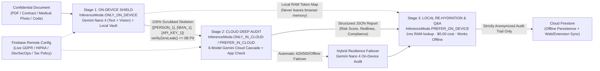

<p align="left">
  
</p>

# VeilAI — Zero-Leak Split-Brain Hybrid AI Workspace

[](https://veilai-hybrid-2026.web.app)
[](./LICENSE)
[](https://firebasehybridaihackathon.devpost.com/)
[](https://firebase.google.com/docs/ai-logic)
[](./packages/hybrid-core/src/localVault.test.ts)

> **Review confidential contracts, medical lab reports, payslips, and source code with Frontier Cloud AI — without a single byte of personal or secret data ever leaving your device.**
>
> 🌐 **Try it live (0 setup, auto Guest Workspace)**: **[https://veilai-hybrid-2026.web.app](https://veilai-hybrid-2026.web.app)**

---

## ⚡ How It Works in 10 Seconds (Built for Anyone)

1. **Open or Drop a Document**: Choose one of the 4 pre-loaded real-world documents (`NDA & Employment`, `Medical Lab Photo`, `Payslip & Tax`, `GitHub PR Secrets`) or click **`Upload`** / drag-and-drop your own **`.pdf`**, **`.png`/`.jpg` photo**, or **text/code file**.
2. **See Your Private Data Protected Locally**: Names, addresses, IBANs, salaries, medical IDs, and API keys are immediately highlighted in your browser (**Emerald** = names & places, **Amber** = financial & IDs, **Rose** = credentials). Click any highlight to toggle protection, or switch to **`Anonymized view`** to see the exact scrubbed draft.
3. **Click `Review document` (or Ask a Question)**:
   * **On-device AI (`Gemini Nano 4`)** shields your private details locally in browser RAM (`0 bytes` leaked).
   * **Cloud AI (`Gemini` via Firebase AI Logic + App Check)** audits only tokenized placeholders (`[COMPANY_1]`, `[PERSON_2]`, `[IBAN_1]`).
   * **Your browser** restores real names on your screen, lets you jump to exact clauses (`Section 3 ↗`), accept revisions, draft counter-proposals, and ask private follow-up questions (`On-device` or `Cloud`).

---

## ⏱️ 60-Second Hackathon Judge Walkthrough

Open **[https://veilai-hybrid-2026.web.app](https://veilai-hybrid-2026.web.app)** (VeilAI automatically creates a 1-click **Guest workspace** on load):

1. **Run Full Split-Brain Review (`0:00 – 0:15`)**: Click **`Review document`** on the pre-loaded NDA contract. Watch the Risk Score (`95/100`), clause issues, and compliance checks appear, while the anonymized audit automatically syncs to **`Recent reviews`** (Cloud Firestore).
2. **Verify Local Re-Hydration & Interactive Redlining (`0:15 – 0:30`)**:
   * Toggle **`With your details` ↔ `Anonymized`** at the top of the Review panel to see real names (`Vespera Cloud Systems SAS`, `Marcus Delacroix`) swap with raw cloud tokens (`[COMPANY_1]`, `[PERSON_2]`).
   * Click **`Section 3 ↗`** on the non-compete issue to scroll to and illuminate Section 3 in the contract, then click **`Accept`**.
3. **Ask a Private Follow-Up Question (`0:30 – 0:45`)**: At the bottom of the Review panel, click **`"Summarize termination risks"`** (`On-device` or `Cloud`) — even follow-up questions are scrubbed of PII locally before execution and re-hydrated in RAM.
4. **Open the Compliance & SDK Inspector (`0:45 – 1:00`)**: Click **`0 bytes leaked · Inspect`** in the top-right header:
   * Inspect live **`result.response.inferenceSource`** SDK traces (`ON_DEVICE` vs `IN_CLOUD`), latency, and exact outbound prompt envelope.
   * Click **`Simulate PII Leak Test`** to watch `verifyZeroLeak()` physically abort a tampered payload before any socket opens (`HARD WIRE GUARD ABORTED LEAK · 0B SENT`).
   * Click **`Simulate Offline`**, switch to **`Medical Lab Photo`** (HIPAA Vision mask), and run an offline summary with **0 network requests**.

---

## 🧠 Why Split-Brain Hybrid Architecture?

Lawyers, physicians, accountants, and engineers face an impossible choice:
* **Cloud-only LLMs** offer deep multi-clause reasoning, **but leak raw PII and secrets** the instant a document leaves the browser — violating GDPR, HIPAA, NDAs, and client privilege.
* **On-device-only models (`Gemini Nano 4`)** guarantee privacy and offline execution, **but have a smaller parameter footprint** than frontier cloud models.

**VeilAI** turns **Firebase AI Logic Hybrid Inference** into a **cryptographic trust boundary** where both on-device and cloud models are indispensable:



### Intentional Use of All 4 Official `firebase/ai` `InferenceMode` Strategies

| Pipeline Stage | `firebase/ai` Mode | Runtime Engine | Why Hybrid Matters Here |
| :--- | :--- | :--- | :--- |
| **1. PII & Secret Shield (Text, PDF & Image)** | `InferenceMode.ONLY_ON_DEVICE` | **Gemini Nano 4** + Deterministic Regex Vault | **Hard privacy guarantee**: never falls back to cloud with raw PII. Works **100% offline**. |
| **2. Quick Summaries, Tone Refinement & Private Q&A** | `InferenceMode.PREFER_ON_DEVICE` | **Gemini Nano 4** → Anonymized Cloud fallback | Instant, **$0.00** local inference when Nano 4 is ready; safely falls back on scrubbed tokens if needed. |
| **3. Deep Expert Legal / Medical / Financial / Code Review** | `InferenceMode.ONLY_IN_CLOUD` *(toggleable to `PREFER_IN_CLOUD`)* | **6-Model Cloud Cascade** (`gemini-3.5-flash-lite` → `gemini-3.8-flash` → `gemini-4-hydrogen`) + **On-Device Failover** | Frontier reasoning on **strictly tokenized text** (`[COMPANY_1]`, `[IBAN_1]`), with automatic on-device failover if cloud quota/network is unavailable. |
| **4. Verifiable Execution Proof** | `result.response.inferenceSource` | Firebase AI Logic SDK Telemetry | Every runtime call records **`ON_DEVICE`** vs **`IN_CLOUD`**, latency (`ms`), wire bytes, and `$0.00` cost savings. |

---

## 📊 Verified Live Production Benchmarks

Measured on **[https://veilai-hybrid-2026.web.app](https://veilai-hybrid-2026.web.app)** in Chrome Desktop (Gemini Nano 4 enabled):

| Operation | `firebase/ai` Mode | Measured `inferenceSource` | Latency | Wire Bytes Sent | Raw PII Leaked |
| :--- | :--- | :--- | :--- | :--- | :--- |
| **Instant Pre-Flight Highlight** | Local RAM Regex + Structural Guard | `LOCAL_REGEX_FALLBACK` | **`< 2 ms`** | `0 B` | **`0 B`** |
| **Stage 1 Semantic PII Shield** | `InferenceMode.ONLY_ON_DEVICE` | **`ON_DEVICE`** (`Gemini Nano 4`) | **`2,243 ms`** | `0 B` | **`0 B`** |
| **Private Follow-Up Q&A (Local)** | `InferenceMode.PREFER_ON_DEVICE` | **`ON_DEVICE`** (`Gemini Nano 4`) | **`3,388 ms`** | `0 B` | **`0 B`** |
| **Offline Quick Summary** | `InferenceMode.PREFER_ON_DEVICE` | **`ON_DEVICE`** (`Gemini Nano 4`) | **`4,022 ms`** | `0 B` | **`0 B`** |
| **Stage 2 Deep Expert Review** | `InferenceMode.ONLY_IN_CLOUD` | **`IN_CLOUD`** (`gemini-3.5-flash-lite`) | **`4,205 ms`** | `2,570 B` *(tokens)* | **`0 B`** |
| **Stage 3 Local Re-Hydration** | In-Memory Vault Lookup | **`ON_DEVICE`** (`Browser RAM`) | **`1 ms`** | `0 B` | **`0 B`** |

---

## 🔒 Security & Zero-Leak Defense-in-Depth

VeilAI enforces **6 independent security layers** so sensitive data cannot leak accidentally or maliciously:

1. **Strict Zero-Cloud-Fallback on Raw Input (`InferenceMode.ONLY_ON_DEVICE`)**:
   Stage 1 never uses `PREFER_ON_DEVICE`. If a reviewer opens VeilAI in a browser without Gemini Nano 4, Stage 1 shields strictly via its deterministic local Regex + Structural Vault (`20` entity categories) with **0 network requests**.
2. **Pre-Socket Mathematical Wire Guard (`verifyZeroLeak()`)**:
   Immediately before any cloud `generateContent` or `generateContentStream` call (including follow-up Q&A!), VeilAI scans the exact outbound string against every enabled vault entity and throws a hard abort if even a single protected substring survives.
3. **100% Client-Side PDF & Image Ingestion + 15 MB DoS Guard**:
   PDF documents are parsed strictly inside browser RAM via a lazy-loaded Web Worker (`pdfjs-dist`), and image OCR runs via on-device Gemini Nano 4 Vision. Client-side file-size (`15 MB`) and character-length (`60,000 chars`) bounds prevent memory-exhaustion DoS.
4. **Emulator-Verified Zero-PII Firestore Rules ([`firestore.rules`](./firestore.rules))**:
   Strict `hasOnly` field allowlists reject any document containing raw PII fields (`rawInput`, `originalText`, `vaultMap`, `entities`, `rehydratedReport`) at the database boundary, while locking `entityCounts` keys to the 20 allowlisted `EntityCategory` enum values (`0..1000`). Per-user isolation (`/users/{uid}/audits/{auditId}`) enforces `request.auth != null && request.auth.uid == userId`.
5. **Firebase App Check + No-Secret Repository Hygiene**:
   All cloud Firebase AI Logic requests are protected by **Firebase App Check**. Zero API secrets, `.env.local` files, or private tokens exist in Git history (verified by automated secret scanning and GitHub Push Protection).
6. **Hardened HTTP Security Headers ([`firebase.json`](./firebase.json))**:
   Production Hosting enforces `Strict-Transport-Security`, `X-Content-Type-Options: nosniff`, `X-Frame-Options: DENY`, `Referrer-Policy: strict-origin-when-cross-origin`, and a locked-down `Permissions-Policy` (`camera=(), microphone=(), geolocation=(), payment=(), usb=()`).

---

## 🧩 Multi-Surface Monorepo Architecture

Both the **Web Workspace (`apps/web`)** and the **Chrome Manifest V3 Side-Panel Extension (`apps/extension`)** share `@veilai/hybrid-core` and synchronize anonymized audit history in real time via Cloud Firestore Offline Persistence:

```text
VeilAI-BuildHybridAI/
├── LICENSE                         # Apache-2.0 Open Source License
├── README.md                       # Project documentation & judge walkthrough
├── package.json                    # npm workspaces root
├── firebase.json                   # Hosting security headers, Auth, Firestore & Remote Config
├── firestore.rules                 # Emulator-verified Zero-Leak per-user security rules
├── firestore.indexes.json          # Composite audit query indexes
├── remoteconfig.template.json      # Live compliance profiles & Gemini model routing template
├── packages/
│   └── hybrid-core/                # Shared Firebase AI Logic Hybrid Engine (@veilai/hybrid-core)
│       └── src/
│           ├── firebase.ts         # App, AppCheck, RemoteConfig, Firestore offline, Auth init
│           ├── hybridRouter.ts     # All 4 InferenceModes, 6-model cloud cascade & Nano 4 failover
│           ├── localVault.ts       # In-memory PII token map, regex guard, custom terms & verifyZeroLeak()
│           ├── localVault.test.ts  # 7 Vitest unit tests verifying zero-leak & re-hydration invariants
│           ├── schemas.ts          # Dual Firebase Schema + Chrome Prompt API JSON Constraints
│           ├── remotePolicy.ts     # Remote Config compliance presets (GDPR/HIPAA/DevSecOps/Tax)
│           ├── auditStore.ts       # Offline-first anonymized Firestore persistence & live sync
│           ├── scenarios.ts        # 4 real-world 1-click evaluation scenarios
│           └── telemetry.ts        # inferenceSource tracking (ON_DEVICE vs IN_CLOUD, $ saved)
├── apps/
│   ├── web/                        # React 19 + Vite 8 Web Workspace (Firebase Hosting)
│   │   ├── public/                 # Bespoke Folded Veil V favicon.svg & apple-touch-icon.png
│   │   └── src/
│   │       ├── components/
│   │       │   ├── VeilLogo.tsx              # Bespoke Folded Veil V architectural SVG monogram
│   │       │   ├── LeftSidebar.tsx           # Workspace navigation, recent reviews & on-device status
│   │       │   ├── DocumentWorkbench.tsx     # Document reader, PDF/image drop, clause focus & legend
│   │       │   ├── InspectorPanel.tsx        # Review dossier, revision tracking, local drafting & Q&A
│   │       │   ├── PrivacyInspectorDrawer.tsx # 1-click judge inspector (SDK traces, leak test, benchmark, RC)
│   │       │   └── AuditHistoryDrawer.tsx    # Real-time Firestore cross-surface sync ledger + restore
│   │       └── utils/
│   │           ├── localPdfParser.ts         # Lazy-loaded 100% client-side PDF.js text extractor
│   │           └── sampleLabImage.ts         # Programmatic clinical lab report PNG generator
│   └── extension/                  # Chrome Manifest V3 Side-Panel Extension (@veilai/extension)
│       ├── public/manifest.json    # MV3 Side Panel + activeTab + Gmail/GitHub/Docs content script
│       └── src/
│           ├── background.ts       # Action-click Side Panel launcher
│           ├── content.ts          # On-demand selection/Gmail/GitHub/Docs extractor
│           └── SidePanelApp.tsx    # Shared Split-Brain UI + auto-guest Firestore sync in Side Panel
└── docs/
    ├── architecture.md             # Split-Brain sequence diagram & Zero-Leak threat model
    └── veilai-logo.svg             # Vector brand mark
```

---

## 🚀 Local Setup & Chrome Extension Installation

### Prerequisites
* **Node.js `>= 20`** and **Chrome Desktop (`v139+`)**
* *(Recommended for true on-device Gemini Nano 4 inference)* Enable Chrome Built-in AI flags:
  1. `chrome://flags/#optimization-guide-on-device-model` → **Enabled BypassPerfRequirement**
  2. `chrome://flags/#prompt-api-multimodal-input` *(or `#prompt-api-for-gemini-nano-multimodal-input`)* → **Enabled**
  3. Relaunch Chrome. VeilAI also includes a 1-click **Enable** button calling `GenerativeModel.initializeDeviceModel()`, and automatically shields locally via its deterministic Regex Vault in browsers without Nano.

### Build & Run Locally
```bash
git clone https://github.com/Weoxx62/VeilAI-BuildHybridAI.git
cd VeilAI-BuildHybridAI
npm install

# Configure Firebase Web App credentials & App Check debug token (gitignored)
cp apps/web/.env.example apps/web/.env.local
cp apps/extension/.env.example apps/extension/.env.local

# Run the 7 Vitest Zero-Leak unit tests & TypeScript check
npm test
npm run typecheck

# Start Web App locally (http://localhost:5173)
npm run dev:web

# Build Chrome Manifest V3 Side-Panel Extension (outputs to apps/extension/dist)
npm run build:extension
```

### Load the Chrome Side-Panel Extension
1. Open `chrome://extensions` in Chrome Desktop and enable **Developer mode** (top-right).
2. Click **Load unpacked** and select the **`apps/extension/dist`** folder *(do not open the `icons` subfolder — select `dist` directly where `manifest.json` lives)*.
3. Open **Gmail, Google Docs, or a GitHub Pull Request**, click the **VeilAI** icon in your Chrome toolbar, and click **`Capture tab`** → **`Review`**.

---

## 📄 License

Licensed under the **Apache License 2.0** — see [LICENSE](./LICENSE) for full terms.
