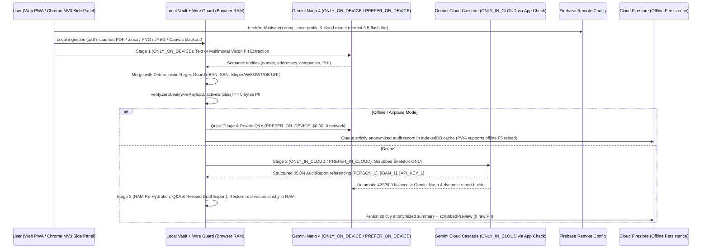

# VeilAI Architecture & Zero-Leak Threat Model

## 1. Split-Brain Hybrid Inference Sequence

VeilAI uses all four official `firebase/ai` `InferenceMode` strategies purposefully so that **both on-device and cloud inference are architecturally indispensable**:

## 2. Hard Zero-Leak Security Invariants

1. **No Cloud Fallback on Raw PII (`InferenceMode.ONLY_ON_DEVICE`)**:
   Stage 1 never uses `PREFER_ON_DEVICE`. If Gemini Nano 4 is unavailable in a reviewer's browser, VeilAI degrades strictly to its local deterministic Regex Vault (`LOCAL_REGEX_FALLBACK`) — raw documents NEVER traverse the network.
2. **Pre-Transmission Wire Guard (`verifyZeroLeak`)**:
   Immediately before calling `model.generateContent(wirePayload)` in Stage 2 (or `PREFER_ON_DEVICE` triage/rewrite/Q&A), VeilAI scans the exact outbound string against every enabled vault entity and throws a hard error if any byte survives unredacted.
3. **100% Client-Side File Ingestion & Interactive Visual Blackout**:
   `.pdf` files (`pdfjs-dist`), scanned image-only `.pdf` pages (rendered onto offscreen `<canvas>` for Vision AI), Word `.docx` archives (`DecompressionStream("deflate-raw")` XML parser), and custom image blackout rectangles execute strictly inside local browser memory.
4. **Zero-PII Firestore Security Rules (`firestore.rules`)**:
   Defense-in-depth `hasOnly` allowlists enforce that raw input fields (`rawInput`, `originalText`, `vaultMap`, `secretMap`, `rehydratedReport`) are rejected at the database layer even if a compromised client attempts to write them.
5. **Firebase App Check (MV3 CSP-Safe) + Per-User Isolation**:
   Every cloud Firebase AI Logic request is protected by Firebase App Check (`CustomProvider` + debug token in Chrome MV3 Side Panel / local testing so zero external scripts violate `script-src 'self'`; reCAPTCHA v3 on production web). Firestore records live strictly under `/users/{uid}/audits/{auditId}` with owner-only rules supporting both Google Sign-In and auto Guest Mode.
6. **Authentic Runtime Execution (`result.response.inferenceSource`)**:
   Every inference call inspects `result.response.inferenceSource` (`InferenceSource.ON_DEVICE` vs `InferenceSource.IN_CLOUD`) with zero mocked AI reports or hardcoded fallback findings.
